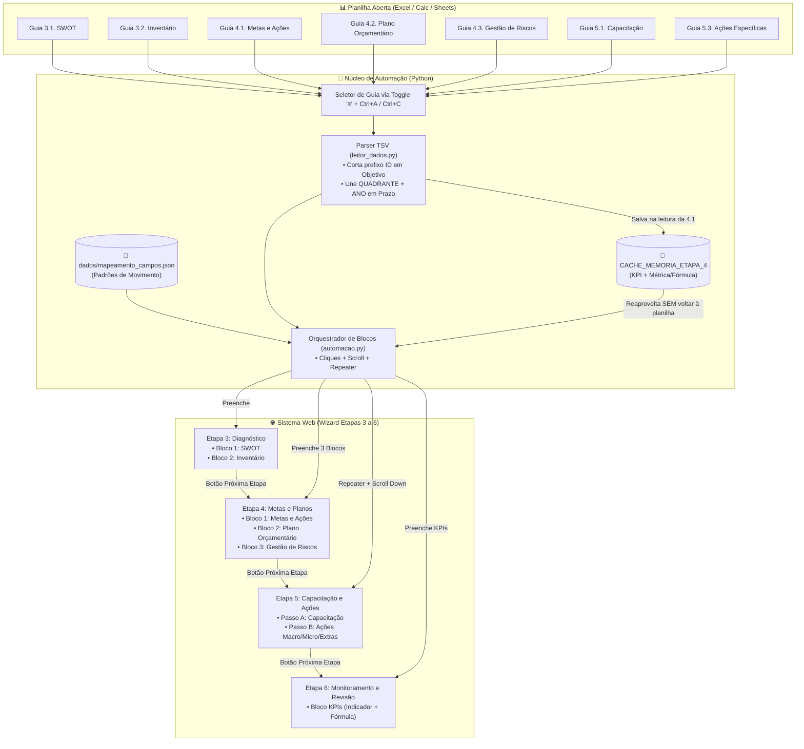

# 🤖 Automação RPA PDTIC — Preenchimento Inteligente Planilha ➔ Sistema Web

> 🚀 **MODO RECOMENDADO (100% Oculto em 2º Plano — Sem usar Mouse/Teclado):**
> Consulte o guia direto em **[`GUIA_COMO_RODAR.md`](GUIA_COMO_RODAR.md)**!
> 1. No terminal: `python main_background.py --tudo --timeout 600` (ou `--analisar` para varredura somente-leitura)
> 2. No Console (`F12`) da guia aberta do Nex Privacy:
>    ```js
>    fetch('http://127.0.0.1:8765/bridge.js').then(r=>r.text()).then(eval)
>    ```

Sistema de Automação Robótica de Processos (**RPA**) desenvolvido em Python para ler guias específicas de uma planilha (Excel / Google Sheets / LibreOffice Calc) e preencher formulários dinâmicos de um sistema web de PDTIC.

O robô combina **4 camadas de localização e interação**:
1. **Navegação e Leitura de Planilha via Toggle `≡` + Área de Transferência (`Ctrl+A` / `Ctrl+C`)**: seleciona a aba correta pelo nome sem depender de posição fixa na barra inferior.
2. **Parser Inteligente de Tabelas TSV (`leitor_dados.py`)**: reconhece sinônimos de cabeçalhos, células mescladas em 2 linhas, une subcolunas duplas (`QUADRANTE` + `ANO`) e higieniza prefixos repetidos (`OE.TIC.1 - `).
3. **Memória Compartilhada Entre Etapas (`CACHE_MEMORIA_ETAPA_4`)**: armazena em memória os indicadores e fórmulas lidos na **Etapa 4** (`4.1. Metas e Ações`) e os reaproveita automaticamente na **Etapa 6** (`6. Monitoramento, Anexos e Revisão`) **sem precisar voltar à planilha**.
4. **Motor Híbrido de Preenchimento (Coordenadas Calibradas + Visão OpenCV/OCR + DOM/CDP)**: interage com campos de texto, listas suspensas (`<select>`) e botões de repetição (`data-repeater-add`), realizando *scroll down* automático à medida que novas caixas são geradas.

---

## 📂 O Que Faz Cada Arquivo do Projeto

```text
automacao/
├── main.py                      # Ponto de entrada principal (CLI) para rodar tudo, uma página ou um bloco isolado
├── treinador.py                 # Treinador interativo ([F8]/[F9]) para ensinar posições de caixas, botões e abas
├── mapeador.py                  # Utilitário auxiliar de inspeção de coordenadas de tela
├── requirements.txt             # Dependências Python do projeto
├── README.md                    # Documentação geral, estrutura, DFD resumido e comandos de teste
├── docs/
│   └── FLUXO_E_DFD_SISTEMA.md   # Documentação aprofundada: DFD Níveis 0, 1 e 2, arquitetura e guia de novos padrões
├── dados/
│   ├── mapeamento_campos.json   # ONDE FICAM GUARDADOS OS PADRÕES DE MOVIMENTO DOS BLOCOS E PÁGINAS
│   ├── cache_etapa_4.json       # (Gerado em execução / ignorado no Git) Cache da Etapa 4 para a Etapa 6
│   └── progresso_execucao.csv   # (Gerado em execução / ignorado no Git) Log de auditoria de cada campo preenchido
└── src/
    ├── config.py                # Constantes globais, modelos de páginas do sistema e sincronização do JSON
    ├── automacao.py             # Orquestrador central das Fases 3, 4, 5 e 6, blocos, scroll e memória
    ├── leitor_dados.py          # Extrator TSV, dicionário de sinônimos e regras de tratamento de strings
    ├── localizador_visual.py    # Visão computacional (OpenCV/OCR), busca Ctrl+F, seleção de abas e medição de scroll
    ├── preenchedor_html.py      # Injeção direta via DOM / WebSocket Chrome DevTools Protocol (CDP)
    └── driver_windows.py        # Driver nativo Win32 (ctypes user32/kernel32) para mouse, teclado, clipboard e parada [ESC]/[F12]
```

### Detalhamento dos Módulos Principais

| Arquivo | Responsabilidade Principal |
| :--- | :--- |
| [`main.py`](main.py) | Recebe os argumentos de linha de comando (`--tudo`, `--pagina4`, `--bloco 4.2`, `--treinar`, etc.), ativa o monitor de parada de emergência (`[ESC]` / `[F12]`) e dispara a execução. |
| [`treinador.py`](treinador.py) | Permite ensinar ao robô onde clicar usando a tecla **`[F8]`**. Calcula deslocamentos relativos (`dx`, `dy`, `passo_y_grupo`) e salva tudo em `dados/mapeamento_campos.json`. |
| [`src/automacao.py`](src/automacao.py) | Contém o motor de execução de blocos (`_executar_roteiro_de_bloco`), a navegação entre fases (`3 -> 4 -> 5 -> 6`), o controle de `repeater` + *scroll* e o cache em memória da Etapa 4 para a Etapa 6. |
| [`src/leitor_dados.py`](src/leitor_dados.py) | Transforma o texto bruto copiado da planilha (`TSV`) em listas de dicionários estruturados, aplicando regras de negócio (corte de ID em Objetivo Estratégico, junção de `QUADRANTE` + `ANO` em Prazo, captura de `MÉTRICA / FÓRMULA`). |
| [`src/localizador_visual.py`](src/localizador_visual.py) | Localiza elementos na tela via `Ctrl+F` (destaque amarelo/laranja do navegador), OCR/OpenCV, seleciona a guia da planilha pelo botão Toggle `≡` e mede quantos pixels a página rolou. |
| [`src/preenchedor_html.py`](src/preenchedor_html.py) | Gera e executa scripts JavaScript diretamente no DOM do navegador (via porta CDP 9222 ou console), acionando `button[data-repeater-add="..."]` e `scrollIntoView`. |
| [`src/driver_windows.py`](src/driver_windows.py) | Comunica-se diretamente com a API Win32 (`user32.dll` / `kernel32.dll`) para mover o mouse, clicar, rolar a página, manipular o Clipboard Unicode e monitorar a parada instantânea em thread dedicada (`watchdog` a cada 15ms). |
| [`src/config.py`](src/config.py) | Define os modelos das 6 etapas do sistema (`PAGINAS_PADRAO_SISTEMA`), tempos de espera e funções de leitura/gravação segura do arquivo `dados/mapeamento_campos.json`. |

---

## 🧭 Onde Ficam Guardados os Padrões de Movimento dos Blocos?

Todos os padrões de movimento, coordenadas de clique, deslocamentos verticais e regras de cada página/bloco ficam salvos no arquivo:

👉 **[`dados/mapeamento_campos.json`](dados/mapeamento_campos.json)**

### Estrutura de `dados/mapeamento_campos.json`

1. **`parametros_referencia`**:
   - Coordenadas globais base da planilha (`planilha`), ponto neutro na tela (`ponto_neutro`) e distâncias relativas padrão entre título, botão `Adicionar` e caixa de texto (`dx_botao_para_campo`, `dy_botao_para_campo`, `passo_y_nova_caixa`).
2. **`coord_toggle_todas_guias`** e **`coord_botao_proxima_etapa`**:
   - Posição do botão Toggle **`≡` (Todas as folhas)** no rodapé da planilha e do botão **`Próxima etapa`** (`data-step-action="next"`) no sistema.
3. **`padroes_paginas`**:
   - Dicionário indexado pelo nome de cada página do sistema (`"3. Diagnóstico"`, `"4. Metas e Planos Obrigatórios"`, `"5. Capacitação, Comunicação e Ações Específicas"`, `"6. Monitoramento, Anexos e Revisão"`).
   - Dentro de cada página ficam guardados:
     - **Bloco 1 (Raiz da página)**: `nome_guia_planilha`, `step_index_sistema`, `coord_guia_sistema`, `campos` e `passos_pagina`.
     - **Bloco 2 (`bloco_2`)**: configuração completa do segundo bloco daquela mesma página (ex: `3.2. Inventário de necessidades`, `4.2. Plano Orçamentário`, `5.3. Ações Específicas`).
     - **Blocos 3 em diante (`blocos_adicionais`)**: lista de blocos extras da página (ex: `4.3. Gestão de Riscos`).

### Os Dois Tipos de Padrão de Movimento (`tipo_passo`)

O robô opera com dois padrões principais de movimento dentro de `passos_pagina`:

1. **`coluna_independente` (Preenchimento Vertical Coluna a Coluna)**
   - **Onde é usado:** Página 3 Bloco 1 (`3.1. SWOT`: Forças, Fraquezas, Oportunidades, Ameaças) e Página 5 (`5.1. Capacitação` e `5.3. Ações Específicas`).
   - **Como se move:**
     1. Preenche o 1º item da coluna na caixa inicial (`sistema_campo_linha1`).
     2. Para o 2º item em diante, clica no botão `+ Adicionar` (`botao_adicionar` / `data-repeater-add`) daquela coluna.
     3. Faz *scroll down* para focar a nova caixa gerada abaixo (`passo_y_nova_caixa` = ~76px) e cola o próximo item sem sobrescrever o primeiro.
     4. Ao terminar todos os itens daquela coluna, passa para a próxima coluna.

2. **`grupo_codependente` (Preenchimento Horizontal Linha a Linha — Multi-Campos)**
   - **Onde é usado:** Página 3 Bloco 2 (`3.2. Inventário`), Página 4 Blocos 1, 2 e 3 (`4.1. Metas e Ações`, `4.2. Plano Orçamentário`, `4.3. Gestão de Riscos`) e Página 6 (`Indicadores de sucesso (KPIs)`).
   - **Como se move:**
     1. Preenche todos os campos da **Linha 1** da esquerda para a direita (ex: os 7 campos de `Metas e ações`).
     2. **Somente após completar todos os campos da linha**, clica no botão `Adicionar` do bloco (ex: `Adicionar ação`, `Adicionar linha`, `Adicionar risco`, `Adicionar KPI`).
     3. Desce a página (*scroll down*) e desloca o eixo Y de todos os campos do grupo pelo valor de `passo_y_grupo` (ex: `276px` ou `215px`), preenchendo a **Linha 2** nas novas caixas vazias criadas abaixo.

---

## 🔄 Diagrama de Fluxo de Dados (DFD) e Funcionamento Geral

> 📄 Para consultar os diagramas DFD Nível 0, Nível 1 e Nível 2 completos e a explicação profunda de cada regra, acesse **[`docs/FLUXO_E_DFD_SISTEMA.md`](docs/FLUXO_E_DFD_SISTEMA.md)**.



---

## 🛠️ Como Criar ou Calibrar Novos Padrões para a Máquina Fazer Sozinha

Existem duas formas de criar ou ajustar um padrão de movimento para qualquer bloco ou página:

### Opção 1: Usando o Treinador Interativo (`treinador.py`) — *Recomendado*
Execute no terminal:
```powershell
.\.venv\Scripts\python.exe treinador.py
```
1. Escolha a página do sistema (de `1` a `6`) ou crie um novo padrão.
2. O treinador perguntará se o bloco é:
   - **Independente por coluna** (cada caixa tem seu próprio botão `+ Adicionar`, como SWOT ou Ações Macro/Micro/Extras); ou
   - **Grupo Codependente** (vários campos preenchidos juntos antes de clicar em `Adicionar`, como Metas e Ações, Plano Orçamentário, Gestão de Riscos e KPIs).
3. Posicione o mouse sobre o local pedido na tela e aperte **`[F8]`**:
   - Na 1ª caixa de cada campo no sistema;
   - No botão `Adicionar` daquele bloco;
   - Na 1ª caixa da **2ª linha** (gerada após clicar em `Adicionar`) — com isso o treinador calcula sozinho o `passo_y_grupo` exato!
4. Tudo é salvo automaticamente em `dados/mapeamento_campos.json`.

### Opção 2: Adicionando um Bloco na Estrutura (`src/automacao.py` / `mapeamento_campos.json`)
Para cadastrar programaticamente um novo bloco em uma página (como feito em `_garantir_estrutura_blocos_fases_4_5_6` em [`src/automacao.py`](src/automacao.py)):
1. Defina a lista de colunas esperadas da planilha (ex: `COLUNAS_MEU_BLOCO = ["CAMPO A", "CAMPO B"]`).
2. Adicione os sinônimos dos cabeçalhos em `SINONIMOS_SWOT` dentro de [`src/leitor_dados.py`](src/leitor_dados.py).
3. Registre o bloco em `padrao_pagina["bloco_2"]` ou na lista `padrao_pagina["blocos_adicionais"]` informando:
   - `"nome_guia_planilha"`: nome da aba na planilha;
   - `"campos"`: coordenadas iniciais `sistema_campo_linha1` e `botao_adicionar`;
   - `"passos_pagina"`: com `"tipo_passo": "grupo_codependente"` ou `"coluna_independente"`.

---

## 🧪 Comandos para Testar Cada Parte e Cada Bloco

> 💡 **Segurança durante os testes:** Em qualquer comando abaixo, basta apertar **`[ESC]`** ou **`[F12]`** uma única vez para **parar o robô instantaneamente**.

### 1️⃣ Testar Cada Bloco Individualmente (Um comando para cada bloco)

| Fase / Página | Bloco / Guia da Planilha | Comando para testar **somente este bloco** |
| :--- | :--- | :--- |
| **Página 3** (`3. Diagnóstico`) | **Bloco 1:** `3.1. SWOT` (Forças, Fraquezas, Oportunidades, Ameaças) | `.\.venv\Scripts\python.exe main.py --bloco 3.1` |
| **Página 3** (`3. Diagnóstico`) | **Bloco 2:** `3.2. Inventário de necessidades` (Descrição, Prioridade, Área, Justificativa) | `.\.venv\Scripts\python.exe main.py --bloco 3.2` |
| **Página 4** (`4. Metas e Planos`) | **Bloco 1:** `4.1. Metas e Ações` (7 campos + salva memória para Etapa 6) | `.\.venv\Scripts\python.exe main.py --bloco 4.1` |
| **Página 4** (`4. Metas e Planos`) | **Bloco 2:** `4.2. Plano Orçamentário` (Plano orçamentário e de investimentos) | `.\.venv\Scripts\python.exe main.py --bloco 4.2` |
| **Página 4** (`4. Metas e Planos`) | **Bloco 3:** `4.3. Gestão de Riscos` (Plano de gestão de riscos) | `.\.venv\Scripts\python.exe main.py --bloco 4.3` |
| **Página 5** (`5. Capacitação...`) | **Passo A (Bloco 1):** `5.1. Capacitação` (Treinamentos técnicos + Retenção de talentos) | `.\.venv\Scripts\python.exe main.py --bloco 5.1` |
| **Página 5** (`5. Capacitação...`) | **Passo B (Bloco 2):** `5.3. Ações Específicas` (Ações macro, micro e extras + *scroll*) | `.\.venv\Scripts\python.exe main.py --bloco 5.3` |
| **Página 6** (`6. Monitoramento...`) | **Bloco 1:** `Indicadores de sucesso (KPIs)` (Reaproveita memória da Etapa 4 sem voltar à planilha) | `.\.venv\Scripts\python.exe main.py --bloco 6.1` |

---

### 2️⃣ Testar uma Página Inteira (Todos os blocos daquela página)

* **Executar toda a Página 3** (`3.1. SWOT` + `3.2. Inventário de necessidades`):
  ```powershell
  .\.venv\Scripts\python.exe main.py --pagina3
  ```
* **Executar toda a Página 4** (`4.1. Metas e Ações` + `4.2. Plano Orçamentário` + `4.3. Gestão de Riscos`):
  ```powershell
  .\.venv\Scripts\python.exe main.py --pagina4
  ```
* **Executar toda a Página 5** (`5.1. Capacitação` + `5.3. Ações Específicas`):
  ```powershell
  .\.venv\Scripts\python.exe main.py --pagina5
  ```
* **Executar toda a Página 6** (`Indicadores de sucesso (KPIs)` via memória da Etapa 4):
  ```powershell
  .\.venv\Scripts\python.exe main.py --pagina6
  ```

---

### 3️⃣ Executar o Fluxo Completo Conectado (Etapas 3 ➔ 4 ➔ 5 ➔ 6) e Limite de Linhas no Teste

Executa todas as páginas e blocos em sequência automática, trocando as abas da planilha e avançando as etapas do sistema:
```powershell
.\.venv\Scripts\python.exe main.py --tudo
```

#### 🔢 Como Limitar a Quantidade de Linhas no Teste (Ex: 5 linhas de cada)
Você pode definir quantas linhas/itens de cada bloco ou coluna serão copiados de duas formas:

1. **Pelo comando no terminal (`--limite N`)**:
   ```powershell
   # Teste completo copiando apenas 5 linhas de cada bloco/coluna:
   .\.venv\Scripts\python.exe main.py --tudo --limite 5

   # Testar apenas o Bloco 3.2 (Inventário) copiando 5 linhas na ORDEM SEQUENCIAL (1 a 5):
   .\.venv\Scripts\python.exe main.py --bloco 3.2 --limite 5
   ```
2. **Pergunta interativa ao iniciar**:
   Se você rodar `.\.venv\Scripts\python.exe main.py --tudo` (ou qualquer comando sem `--limite`), o sistema perguntará no terminal antes de começar:
   > `🔢 Quantas linhas de cada bloco/coluna deseja copiar neste teste? (Ex: digite 5, ou aperte [ENTER] para copiar TODAS):`

> 📌 **Ordenação por `ORDEM SEQUENCIAL` na aba `3.2. Inventário de necessidades`:**
> Ao ler a aba `3.2. Inventário de necessidades`, o robô localiza automaticamente a coluna **`ORDEM SEQUENCIAL`** e ordena todas as linhas em sequência crescente (`1, 2, 3, 4, 5...`) antes de aplicar o limite e iniciar a colagem no sistema.

---

### 4️⃣ Comandos de Treinamento / Calibração

* **Abrir o menu do Treinador Interativo:**
  ```powershell
  .\.venv\Scripts\python.exe treinador.py
  ```
* **Treinar o fluxo completo conectado e já iniciar a execução:**
  ```powershell
  .\.venv\Scripts\python.exe main.py --treinar-completo
  ```
