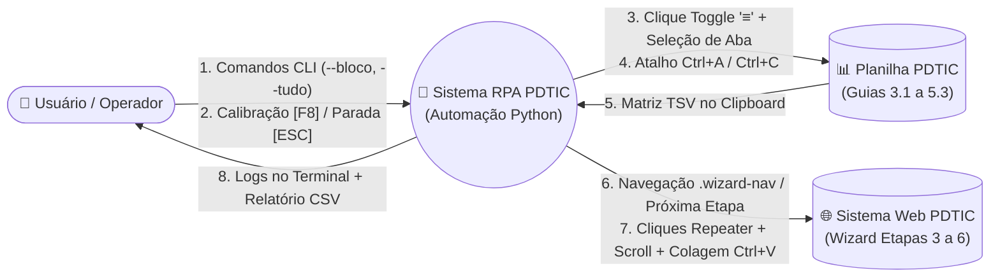
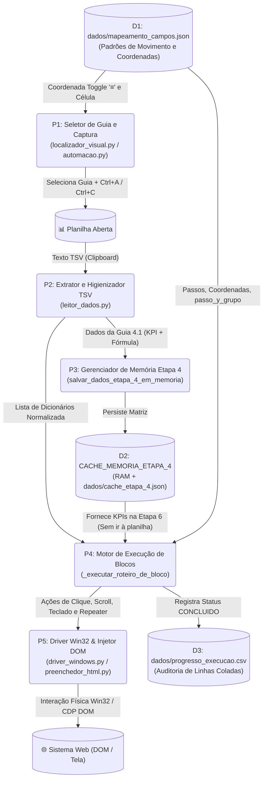
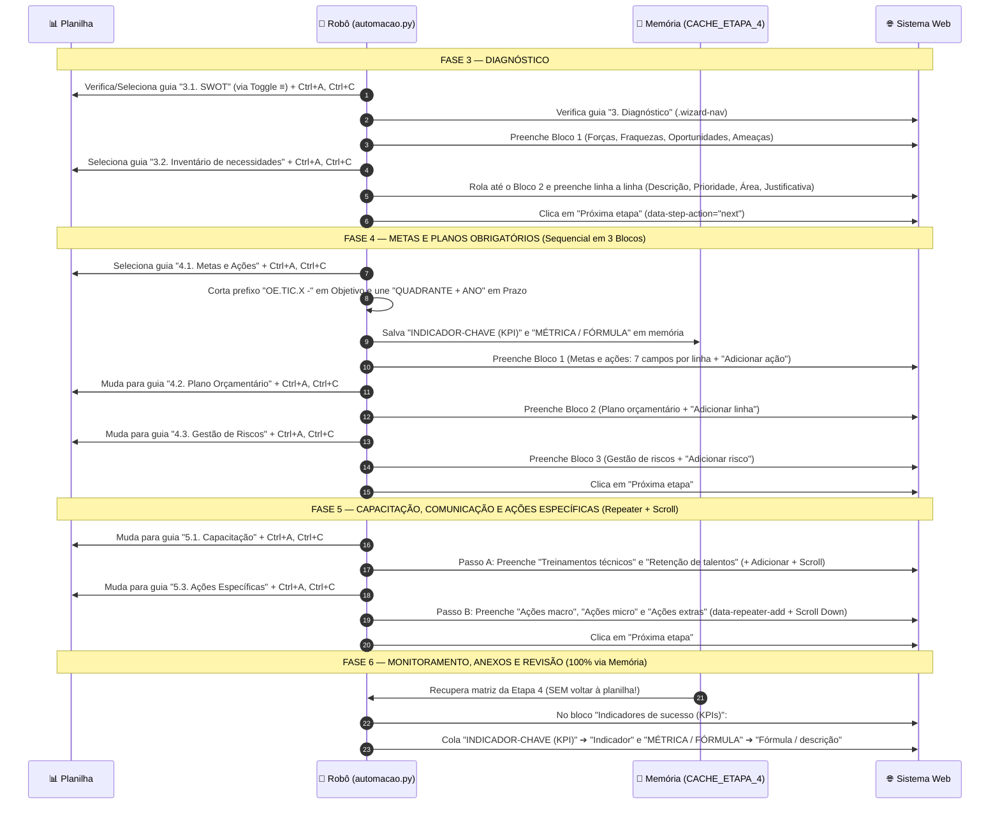

# 📐 Arquitetura, Fluxo de Funcionamento e DFD (Diagrama de Fluxo de Dados)

Este documento detalha o funcionamento interno da automação RPA PDTIC, os **Diagramas de Fluxo de Dados (DFD)** em múltiplos níveis, a anatomia do arquivo de padrões de movimento (`dados/mapeamento_campos.json`) e o guia passo a passo para ensinar novos padrões ao robô.

---

## 1. Diagramas de Fluxo de Dados (DFD)

### 1.1. DFD Nível 0 — Diagrama de Contexto

Representa o sistema de automação como um processo único interagindo com as entidades externas: **Usuário/Operador**, **Planilha (Excel/Sheets/Calc)** e **Sistema Web PDTIC**.



---

### 1.2. DFD Nível 1 — Processos Internos e Depósitos de Dados

Detalha como o dado sai da planilha, passa pelo parser TSV, alimenta o depósito de memória da Etapa 4 e guia os movimentos do mouse/teclado/DOM.



---

### 1.3. DFD Nível 2 — Fluxo Detalhado de Execução por Etapa (3 ➔ 4 ➔ 5 ➔ 6)



---

## 2. Explicação das Regras Complexas do Sistema

### 2.1. Seleção de Aba na Planilha Independente de Posição (Toggle `≡`)
Na planilha, a posição das abas na barra inferior muda conforme a rolagem horizontal. Para nunca clicar na aba errada:
1. O robô primeiro faz uma leitura rápida (`Ctrl+A` / `Ctrl+C`) para checar se a aba atual já contém os cabeçalhos esperados (`_confirmar_correspondencia_guia_planilha`).
2. Se não estiver na aba certa, clica no botão **Toggle `≡` (Todas as folhas)** no canto inferior esquerdo da planilha (`coord_toggle_todas_guias`).
3. Com o menu vertical aberto, localiza o nome exato da aba (ex: `4.2. Plano Orçamentário`) via OCR/OpenCV (`selecionar_guia_planilha_via_toggle_e_nome`) e clica nela.

### 2.2. Tratamento de Strings na Guia `4.1. Metas e Ações` (`src/leitor_dados.py`)
- **Corte do Prefixo repetido em `OBJETIVO ESTRATÉGICO`**:
  - Na planilha, a célula vem como `"OE.TIC.1 - Fornecer serviços de TIC eficazes..."`.
  - Como o código `"OE.TIC.1"` já é colado no 1º campo (`ID`), a função `limpar_objetivo_estrategico` remove automaticamente o prefixo `"OE.TIC.X - "` antes de colar no 2º campo.
- **União da Coluna Dupla `PRAZO` (`QUADRANTE` + `ANO`)**:
  - Na planilha, `PRAZO` é uma célula mesclada no topo dividida em duas subcolunas abaixo (`QUADRANTE` e `ANO`).
  - A função `_detectar_subcolunas_prazo` identifica os índices das duas subcolunas e concatena seus valores separados por um espaço (ex: `"1º Quadrante 2026"`).
- **Captura Silenciosa de `MÉTRICA / FÓRMULA`**:
  - Mesmo não sendo colada na Página 4, a coluna `MÉTRICA / FÓRMULA` da guia `4.1` é extraída junto com cada linha e guardada sob a chave `"FÓRMULA / DESCRIÇÃO"` para uso futuro na Etapa 6.

### 2.3. Interação com `Repeater` e *Scroll Down* Dinâmico (`src/automacao.py`)
Quando o robô preenche várias linhas em um bloco dinâmico:
1. **Linha 1 (`idx == 0`)**: clica nas coordenadas base `sistema_campo_linha1` de cada campo e cola o valor.
2. **Linha 2 (`idx == 1`)**:
   - Clica no botão `Adicionar` do bloco (`data-repeater-add`).
   - Faz um *scroll down* calibrado na página para garantir que a nova linha gerada abaixo fique visível na tela.
   - Mede via comparação de imagem (`_medir_scroll_por_template`) quantos pixels a tela realmente deslocou e calcula a nova posição vertical exata:
     $$\text{Y}_{\text{novo}} = \text{Y}_{\text{linha 1}} + \text{passo\_y\_grupo} - \Delta\text{Y}_{\text{scroll}}$$
3. **Linha 3 em diante (`idx >= 2`)**:
   - Caso o botão `Adicionar` fique no topo do card (`ancorado_no_topo: true`), o robô sobe até o botão, clica em `Adicionar`, desce até a nova linha gerada no final do bloco e preenche os novos inputs vazios.

---

## 3. Onde Ficam e Como Funcionam os Padrões de Movimento (`dados/mapeamento_campos.json`)

O arquivo [`dados/mapeamento_campos.json`](../dados/mapeamento_campos.json) é o "cérebro espacial" do robô. Veja o papel de cada propriedade dentro de um bloco:

```json
{
  "nome_bloco": "Plano orçamentário e de investimentos",
  "nome_guia_planilha": "4.2. Plano Orçamentário",
  "titulo_coluna_confirmacao": "Plano orçamentário",
  "ativo": true,
  "ir_para_topo_no_inicio": false,
  "rolar_ate_o_final_no_inicio": true,
  "campos": {
    "AÇÃO (ID)": {
      "coluna_planilha": "AÇÃO (ID)",
      "planilha_linha1": [-1534, 588],
      "sistema_campo_linha1": [730, 620],
      "botao_adicionar": [1755, 510],
      "tipo": "caixa_texto",
      "tem_adicionar": true,
      "passo_y_grupo": 215
    }
  },
  "passos_pagina": [
    {
      "tipo_passo": "grupo_codependente",
      "nome_passo": "Plano orçamentário e de investimentos",
      "titulo_card_busca": "Plano orçamentário e de investimentos",
      "texto_botao_adicionar": "Adicionar linha",
      "data_repeater_add": "budget-plan",
      "campos": ["AÇÃO (ID)", "DESCRIÇÃO DO CUSTO", "FONTE DE RECURSO", "ANO 1", "ANO 2", "ANO 3", "ANO 4"],
      "botao_adicionar": [1755, 510],
      "passo_y_grupo": 215
    }
  ]
}
```

### Significado de cada chave:
- **`sistema_campo_linha1`**: Coordenada `[X, Y]` da primeira caixa de texto daquele campo na tela.
- **`botao_adicionar`**: Coordenada `[X, Y]` do botão `Adicionar` que cria uma nova linha/caixa.
- **`tipo`**:
  - `"caixa_texto"`: campo `<input>` ou `<textarea>` onde o texto é colado com `Ctrl+V`.
  - `"barra_suspensa"`: campo `<select>` onde o robô abre a lista e seleciona a opção correspondente (`opcoes`).
- **`passo_y_grupo`**: Distância vertical (em pixels) entre o 1º grupo de campos e o 2º grupo gerado abaixo após clicar em `Adicionar`.
- **`data_repeater_add`**: Valor do atributo HTML `data-repeater-add="..."` do botão (usado quando o preenchimento via DOM/JS está ativo).

---

## 4. Como Criar um Novo Padrão para a Máquina Executar Sozinha

Se o sistema ganhar uma nova aba ou um novo bloco no futuro, siga estes **3 passos simples**:

### Passo 1: Cadastrar os nomes das colunas em `src/leitor_dados.py`
Adicione os nomes das colunas da planilha no dicionário `SINONIMOS_SWOT` em [`src/leitor_dados.py`](../src/leitor_dados.py) para que o extrator TSV reconheça os cabeçalhos mesmo com variações de acento ou quebra de linha.

### Passo 2: Calibrar as posições na tela com o `treinador.py`
Rode no terminal:
```powershell
.\.venv\Scripts\python.exe treinador.py
```
1. Escolha a página onde o novo bloco fica.
2. Escolha a opção de **Adicionar/Treinar Grupo Codependente (ou Coluna Independente)**.
3. Aponte com o mouse e aperte **`[F8]`** em cada caixa da 1ª linha, depois no botão `Adicionar`, e por fim na 1ª caixa da 2ª linha.
4. O treinador grava tudo automaticamente em `dados/mapeamento_campos.json`.

### Passo 3: Testar o bloco isoladamente
Use o comando `--bloco` no [`main.py`](../main.py) para validar o movimento do bloco recém-criado antes de rodar a sequência inteira!
